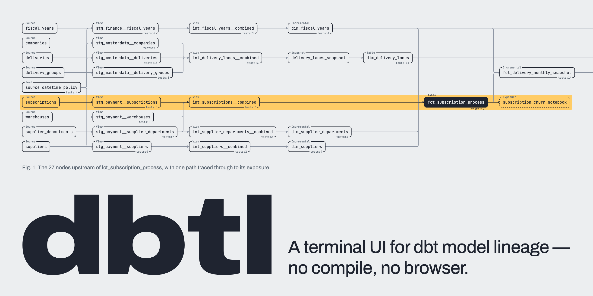

<p align="center">
  
</p>

<p align="center">
  <a href="https://github.com/hytfjwr/dbtl/actions/workflows/ci.yml"></a>
  <a href="https://github.com/hytfjwr/dbtl/actions/workflows/security.yml"></a>
  <a href="https://github.com/hytfjwr/dbtl/releases"></a>
  <a href="LICENSE"></a>
  
</p>

<p align="center">
  <a href="#install">Install</a> ·
  <a href="#quick-start">Quick start</a> ·
  <a href="#features">Features</a> ·
  <a href="#usage">Usage</a> ·
  <a href="#keybindings">Keybindings</a>
</p>

---

`dbtl` draws your dbt project's dependency graph in a two-pane terminal UI. Pick a model on the left and its lineage appears on the right, so you can answer *"what does this model depend on, and what does it affect?"* without running `dbt compile` or opening a browser.

```
╭Seed────────────────────╮   ╭View───────────────────╮   ╭View────────────────────╮
│ source_datetime_policy │──▶│ stg_payment__shoppers │──▶│ int_shoppers__combined │
╰────────────────tests:4─╯  │╰───────────────tests:5─╯   ╰────────────────────────╯
                            │
╭Source────╮                │
│ shoppers │────────────────╯
╰──────────╯
```


## Install

```console
$ brew install hytfjwr/tap/dbtl
```

Homebrew works on macOS and Linux. Other options:

- **Prebuilt binaries.** Download a tarball for your platform from the [releases page](https://github.com/hytfjwr/dbtl/releases). `checksums.txt` is included.
- **From source** (Rust 1.92+):

  ```console
  $ git clone https://github.com/hytfjwr/dbtl.git
  $ cd dbtl
  $ cargo install --path .
  ```

## Quick start

Run it at the root of any dbt project:

```console
$ dbtl
```

If `target/manifest.json` exists, `dbtl` uses it. Otherwise it parses the project source directly.

Source mode infers lineage from the raw SQL without rendering Jinja, so a compiled manifest is always more accurate. If `dbt` is on your `PATH`, press `P` inside the app to run `dbt parse` and switch to the generated manifest in place.

A manifest (including a dbt Fusion–written one) that carries resource types `dbtl` does not handle still loads: unsupported/unknown `resource_type`s are kept as generic lineage nodes and a non-empty `functions` map is reported — each surfaces as one stderr/`r`-toast warning per kind rather than dropping silently.

## Features

<table>
<tr>
<td width="50%" valign="top">

### No compile, no browser
`dbtl` builds lineage from `dbt_project.yml`, model `.sql` files (`ref()` / `source()`) and `schema.yml`. It is a single static binary and runs entirely in the terminal, including over SSH. There is no `dbt docs serve` step.

</td>
<td width="50%" valign="top">

### Navigate the graph itself
Move a cursor between lineage nodes and re-root on any model. You can filter by direction and depth, and go back and forward through your re-root history. A mouse click on a node re-roots too.

When one column stacks more than `lineage_collapse` same-parent siblings (default 8, see [State and config](#state-and-config)), the tail folds into a single `+N more` box so giant hubs stay navigable. `Enter` — or a click — on it expands the group into all its members behind a `-N less` box, and `Enter` again collapses it back. Which siblings stay visible is deterministic: the cursor, the root↔cursor path, and bookmarks always show, the rest fill in `unique_id` order. A `/` lineage search that lands on a hidden member expands its group automatically, and expansions reset when you re-root.

Collapsing is a display concern: the Mermaid (`m`/`ym`) and DOT (`x`/`yx`) exports always emit every real node. The ASCII copy (`c`/`yc`) and the `e` diagram export keep their long-standing "exactly what the pane draws" contract — markers included, so expand a group first if you want its members in the text.

</td>
</tr>
<tr>
<td valign="top">

### Trace a path
The path from the root to the cursor lights up, including the connectors between nodes, and everything off the path dims. Anchor the path's start on the selected model with `p` and it answers "why does X reach Y" for any two nodes — dbt's `A+,+B`. Compact mode (`v`) shrinks boxes to one-row nodes for big graphs. Overview mode (`w`) shows the whole DAG.

</td>
<td valign="top">

### Coverage and impact lenses
Lenses tint the lineage by test coverage, downstream blast radius, layer, layer violation, static lint findings, or `--diff` changes — and, with `run_results.json` loaded, by last-run status and runtime heat. The **primary-key lens** tints models whose columns lack a `unique` + `not_null` pair or a `unique_combination_of_columns` test — the same guarantee `dbtl check --lint`'s `missing_primary_key_tests` rule evaluates. There is also a stats dashboard, a key to jump between untested models, and one-key export to Mermaid, Graphviz, or a Markdown impact report.

</td>
</tr>
<tr>
<td valign="top">

### Review a branch with `--diff`
Compare against another manifest or checkout. Added models show green and modified ones amber. `D` opens a PR impact report that lists changed nodes with reasons, downstream blast radius, affected marts, exposures, and owners (from a `meta` key, default `owner`), a ready-to-run `dbt build --select …`, and risk flags. Press `e` to export it as Markdown.

</td>
<td valign="top">

### Exposures and the semantic layer
dbt exposures such as dashboards and notebooks appear as end nodes at the right edge of the lineage, in both manifest and source mode — and a compiled manifest adds semantic models, metrics, and saved queries there too. The impact report lists each affected exposure with its type and owner, dbt unit tests count toward the `tests:N` badge, and the `Enter` structure view shows governance fields (access, group, contract, version) and the `meta` dict (sorted, nested values as compact JSON) when declared.

</td>
</tr>
<tr>
<td valign="top">

### The last run and the warehouse
`dbtl` auto-detects `run_results.json` and `catalog.json` next to the data source (usually under `target/`). The last run adds two `t` lenses — per-node status and runtime heat — a status chip, and a runtime-weighted critical path in the `S` dashboard. The catalog puts real column types, row counts, and a schema↔warehouse drift check in the `Enter` structure view.

</td>
<td valign="top">

### Search and select like dbt
The `/` list search takes a `!`-prefixed dbt selector (`!tag:nightly`, `!+fct_orders`, `!meta:owner=alice`, `!state:modified+` with `--diff`) or a `?`-prefixed full-text query over descriptions, column names, and raw SQL. `--select` accepts the same selectors minus `state:` (it resolves to the first matching model). `meta:key` matches key existence; `meta:key=value` matches the stringified value.

</td>
</tr>
</table>

## Usage

```console
# Auto-detect: reads ./target/manifest.json if present, otherwise parses ./ as source
$ dbtl

# Point at a project directory
$ dbtl --project /path/to/dbt-project

# Force a mode
$ dbtl --manifest /path/to/target/manifest.json
$ dbtl --source /path/to/dbt-project

# Select a model at startup — a name, or a dbt selector spec (first matching
# model wins; `state:` is unavailable — it resolves before --diff loads)
$ dbtl --select stg_orders --watch              # --watch: auto-reload on source changes
$ dbtl --select 'tag:nightly'
$ dbtl --select 'meta:domain=sales'             # meta:key / meta:key=value selectors

# Include models installed from dbt packages in the graph (manifest mode —
# the default scope is the root project only)
$ dbtl --include-packages

# Pick a color theme (or set DBTL_THEME)
$ dbtl --theme ayu-mirage
$ dbtl --list-themes

# Diff against a baseline: "what does my branch change?"
$ dbtl --diff /path/to/main-checkout            # another worktree (or its manifest.json)
$ dbtl --diff target/manifest.prod.json         # a saved production manifest

# The last run's statuses + runtimes (target/run_results.json is auto-detected)
$ dbtl --run-results /path/to/run_results.json

# Generate static Markdown docs (no TUI)
$ dbtl docs --out ./dbt-docs                    # auto-detect the data source, write into ./dbt-docs
$ dbtl docs --manifest target/manifest.json --out docs/lineage
$ dbtl docs --source /path/to/project --out ./dbt-docs --quiet   # no compile needed; CI-quiet
$ dbtl docs --out ./dbt-docs --clean            # also delete stale generated pages
$ dbtl docs --out ./dbt-docs --check            # write nothing; exit 1 if docs are stale

# PR impact + CI gates (no TUI)
$ dbtl impact --diff /path/to/main-checkout                       # PR impact pack as Markdown
$ dbtl impact --diff target/manifest.prod.json --format json      # same payload as JSON
$ dbtl check --coverage-min 80                                    # fail under 80% test coverage
$ dbtl check --diff /path/to/main-checkout --coverage-min 80      # + new violations & untested changes
$ dbtl check --diff /path/to/main-checkout --no-breaking          # + breaking column changes still read downstream
$ dbtl check --lint                                               # + static structure lint (one gate per rule)
$ dbtl check --lint --diff /path/to/main-checkout                 # lint gates on NEW violations only
$ dbtl check --rules root_models,undocumented_models              # a subset of rules (implies --lint)
$ dbtl check --lint --format json                                 # the whole report as JSON
```

### How `--diff` compares

The diff identifies nodes by `unique_id`, so a rename shows up as one node removed and another added — which is also how every downstream `ref()` sees it. It compares the surfaces a dbt change actually moves: materialization, direct dependencies, columns, tests, and model SQL.

When both sides are compiled manifests, a change inside a shared **macro** is caught too: the diff reads each manifest's `macros` plus every node's `depends_on.macros` and marks callers of a changed macro — including transitive macro→macro calls — with a `macro:<name>` reason. That is the one surface raw SQL can't show.

#### Column-level breaking changes

On top of the node-level comparison, every `modified` node gets a **column diff** through the same column-level-lineage engine `dbtl columns` uses (catalog → declared `schema.yml`/manifest columns → SQL-derived outputs, so the diff resolves columns exactly like every other surface). Each changed column is classified:

- **removed** — a baseline output name no current column carries;
- **renamed** — detected when a dropped name and a new name draw from the same upstream column (`status as order_status`);
- **type changed** — `data_type` differs (catalog first, then declared);
- **expression changed** — the normalized SELECT expression differs (formatting, comments, and keyword casing never count);
- **added** — a new output column.

Severity is what the downstream picture proves: a removed or renamed column that still has readers — consumers whose reference now resolves to nothing, or that remain linked to the changed node — is **breaking**; type and expression moves are **partial-breaking**; added columns and unreferenced removals are **non-breaking**. Each finding lists the downstream columns, models, marts, and exposures it reaches, so the `D` modal and the impact report answer "which downstream columns and dashboards break" precisely — and a narrower `dbt build --select` lists exactly the models the changed columns reach (a column-clean change keeps its `+` fan-out only while the analysis can't prove otherwise). All of it is the same `column_changes` payload in the modal, the Markdown, and `--format json`.

Both sides of a diff are loaded under the same package scope, so a compiled-manifest baseline and a source-parsed current side now compare cleanly by default — see the next section.

#### Package scope: root project by default (`--include-packages`)

**Breaking change:** a compiled manifest mixes `deps`-installed packages (`dbt_utils`, …) into `nodes`, and dbtl used to load them all. The default scope is now the **root project only** — installed-package nodes are pruned at load, exactly like source mode (which never parses `dbt_packages/`). Manifest mode and source mode now agree on the node set, and every metric — test coverage, orphan models, the `S` stats dashboard, the docs README summary, `dbtl check`, the PR-impact risk flags — counts the root project under either scope.

`--include-packages` widens the scope back to the manifest's full contents: package nodes appear in the model list, lineage, and docs pages as dependency context (a package model's lineage edge is real — it just isn't *your* model). The metrics still count the root project only. The flag is global, so `dbtl --include-packages check` and `dbtl check --include-packages` are equivalent.

Under the default scope the prune is graph-wide — the lineage pane included. A root model whose only upstream (or downstream) was a package node shows no edge there at all: the same shape source mode draws for an unresolvable `ref()`, since installed packages are simply invisible rather than marked as pruned. A visual marker for those pruned package edges is a future follow-up; until then `--include-packages` is the way to see them.

The scope is always visible where numbers are reported: the status bar shows `scope:root` (or `scope:+pkgs`), the generated docs README leads its summary with a `- scope:` bullet, `dbtl check` prints a `scope:` line, the `D` diff modal and the `dbtl impact` report carry it in the header.

The owning package is the manifest's `metadata.project_name` (the root project dbt recorded; on old manifests without it, the most frequent `model.<pkg>.<name>` uid segment — a heuristic dbtl warns about when several packages are present and the guess is genuinely ambiguous). On such unrecorded manifests the *displayed* project name (title bar, docs index) can differ from the *scoped* package: the display name takes the lexicographically smallest uid segment for stability while the scope follows the most frequent one — under recorded metadata they always agree. `--project-only` still parses for backwards compatibility but is a deprecated no-op — the default already is what it asked for — and prints a deprecation warning on stderr (it also conflicts with `--include-packages`). In source mode `--include-packages` is a no-op with a warning, since installed packages are never parsed.

### The last run and the warehouse

Two more dbt artifacts are picked up automatically when they sit next to the data source — the manifest's directory (usually `target/`) in manifest mode, `<project>/target/` in source mode. A missing file just means less data, never an error.

- **`run_results.json`** — the last `dbt run`/`build`/`test` outcome — adds two `t` lenses after Diff: **RunStatus** (error/fail → red, warn → yellow, skipped → muted; success keeps the node colour) and **RunTime** (execution-time heat on the same low/mid/high ramp as blast radius). The status bar gains a `run 12/34 @2024-05-01` chip — how many of the graph's nodes the artifact covers plus its date, so a stale or partial run is visible — and the `S` dashboard a runtime-weighted critical path. Pass `--run-results <path>` to point at a different file; `r` reload re-reads it, so `--watch` picks up a fresh `dbt run` in place (manifest mode — the run rewrites the manifest).
- **`catalog.json`** — the warehouse record `dbt docs generate` writes — makes the `Enter` structure view show what the warehouse actually has: real column types, row counts, byte size, and a `drift:` line when the documented columns and the warehouse disagree (documented-but-missing vs undocumented).

### Markdown docs (`dbtl docs`)

`dbtl docs --out <DIR>` never starts the TUI, so it runs in CI without a TTY. It writes a Markdown documentation tree that you can commit to a repo and read on GitHub or GitLab:

- **One page per node** — model, source, seed, snapshot, exposure, plus semantic models, metrics, and saved queries from a compiled manifest. Each page has the description, materialization, schema, tags, a sorted `meta` table, a column table in dbt definition order, tests (with the `relationships` target linked and the unit-test `in:`/`given:`/`expect:` row counts where the manifest records them), direct and transitive upstream/downstream links, and a Mermaid lineage diagram.
- **An index `README.md`** with a project summary enumerating every resource type in the graph (the counts always sum to the total), test coverage %, column-level coverage (tested declared columns — the same numbers the stats dashboard quotes), a list of orphan models, a linked table of every node, and a whole-project Mermaid diagram. Large projects get the diagram split by layer.

The data source is chosen the same way as in the TUI (`--manifest` / `--source` / `--project` / auto-detect). The output is deterministic: regenerating from the same input produces byte-identical files.

Every generated file starts with a `<!-- Generated by dbtl. Do not edit. -->` marker. Two housekeeping flags rely on it:

- **`--clean`** writes the docs, then deletes marked files under `<DIR>` that this run did not regenerate, such as the pages of removed or renamed models. Only marked files are ever removed, so a hand-written `.md` in the same directory is safe.
- **`--check`** writes nothing. It compares the generated set against `<DIR>`, prints one line per difference (a missing, changed, or stale marked file), and exits 1 if there are any. Unlike running `git diff --exit-code` after regenerating, it also catches stale pages, and it needs no checkout step in CI: `dbtl docs --out docs/ --check`.

### PR impact + CI checks (`dbtl impact` / `dbtl check`)

Two more non-interactive subcommands (no TTY needed — both return before any
terminal init, just like `dbtl docs`). They compute the *same*
`dbtl_core::diff_report` payload the TUI's `D` diff modal snapshots, so a CI
comment can never disagree with the screen.

- **`dbtl impact --diff <BASELINE>`** prints the PR impact pack — the diff
  listings (added / removed / modified / edge changes), the **Column changes**
  section (per-column classification + the downstream columns/models/marts/
  exposures each reaches), the aggregate blast radius, affected marts,
  exposures, and owners, suggested `dbt build --select …` commands
  (model-granular *and* the column-narrowed one), and the risk flags — as
  **Markdown** (the exact bytes the `D`→`e`
  export writes; paste or post as a PR comment). `--format json` emits the
  `DiffReport` payload verbatim for automation. The "Affected owners" section
  collects distinct values of a `meta` key (default `owner`, set
  `owner_meta_key` in `config.yml`) off the affected downstream nodes —
  changed nodes themselves are excluded.
- **`dbtl check`** prints one `PASS`/`FAIL` line per gate and exits 1 when any
  fails. Gates: **`--coverage-min <pct>`** (test coverage below the
  threshold — the same `coverage_gap` counts the status `cov%` shows), and —
  with `--diff <BASELINE>` — **newly introduced layer violations**,
  **changed models/seeds/snapshots without tests** (the impact pack's risk
  flags), and with **`--no-breaking`** any **breaking column change still
  referenced downstream** (removed/renamed columns whose readers didn't
  migrate — the failure line names each `model.column`, `old -> new` for
  renames; partial-breaking type/expression moves report but never trip it).
  **`--lint`** adds one gate per static structure rule (see the next
  section) — and under `--diff` only violations that did not exist in the
  baseline fail it. **`--rules a,b,c`** runs a named subset (implies
  `--lint`), **`--format json`** serializes the whole report for automation.
  A `--diff` run also prints informational (non-gating) lines — the resolved
  baseline label and the same `affected owners:` set the impact report lists.
  `--quiet` suppresses the report for an exit-code-only check.

Example GitHub-Actions shape:

```sh
dbtl impact --manifest target/manifest.json --diff "$BASE/target/manifest.json" \
    >> "$GITHUB_STEP_SUMMARY"
dbtl check  --manifest target/manifest.json --diff "$BASE/target/manifest.json" \
    --coverage-min 80 --lint
```

### Static project lint (`dbtl check --lint`, `.dbtl.yml`)

The `dbt_project_evaluator`-style best-practice checks — the ones that package
normally materializes in your warehouse — evaluated **statically** against the
same `Dag` everything else reads. No warehouse connection, no `dbt run`, and in
source mode not even `dbt parse`/`dbt compile`: a CI run is seconds, and the
results are deterministic.

One `run_rules` findings vector feeds every surface, so the numbers can never
drift apart: `dbtl check --lint` gates on it, the TUI's **Lint** `t`-lens tints
every violating node violation-red and the `S` dashboard adds a per-rule
worklist, and `dbtl docs` puts a Lint summary in the generated README plus a
"Lint violations" section on each node's page.

The initial rule set (all enabled by default):

| Rule | Flags |
| --- | --- |
| `direct_join_to_source` | a model directly depends on both a source and a model |
| `multiple_sources_joined` | a model directly depends on 2+ sources |
| `source_fanout` | a source directly feeds ≥ `source_fanout_threshold` models (default 2) |
| `model_fanout` | a model directly feeds ≥ `model_fanout_threshold` leaf models (default 5, the hub threshold) |
| `root_models` | a model has no parents |
| `rejoining_upstream` | a redundant hop: A→B→C while A→C also exists and B has no other data-node child (endpoint resources like exposures don't count as a use) |
| `marts_depend_on_source` | a marts/intermediate model directly depends on a source (layer resolved prefix-first — `staging/fct_x` counts as marts) |
| `missing_primary_key_tests` | a model lacks `unique`+`not_null` on the same column or `unique_combination_of_columns` |
| `public_models_without_contract` | `access: public` without `contract: enforced` |
| `undocumented_models` | a model has no description |
| `naming_conventions` | a model's name misses its resolved layer's prefix (`stg_`, `int_`, `fct_`/`dim_`/`rpt_`) |
| `layer_violation` | a backward edge between logical layers — the shared `layer_violation_edges` predicate |

Rule policy lives in the **project-local `.dbtl.yml`** — deliberately *not*
`~/.config/dbtl/config.yml`, because a CI gate must not depend on the
developer's machine. In source mode the project dir is searched; in manifest
mode a `<root>/target/manifest.json` layout looks at the project root first,
then `target/` itself (a manifest anywhere else only consults its own
directory — no unrelated parent `.dbtl.yml` is picked up). A malformed file
is an error for `check` and `docs` (the TUI warns and falls back to
defaults).

```yaml
# .dbtl.yml — every key optional; absent rules stay enabled
lint:
  rules:
    model_fanout: false        # disable individual rules
    naming_conventions: false
  model_fanout_threshold: 4    # flag models feeding 4+ leaf models
  source_fanout_threshold: 3
  naming_prefixes:             # per-layer merge over the defaults
    staging: [stg_, base_]     # staging/ also accepts base_
    marts: []                  # marts/ is unchecked
    other: [rpt_]              # flag unclassified models without rpt_ (evaluator parity)
```

`dbtl check --lint --diff <BASELINE>` compares finding *keys* against the
baseline's — only **newly introduced** violations gate (the same "new only"
idea as the layer-violation gate), so adopting lint on a large existing
project doesn't force a flag day: land `.dbtl.yml`, keep `main` green, and PRs
fail only on the violations they add.

Differences from `dbt_project_evaluator`: dbtl evaluates the pruned in-scope
graph (root project by default — installed-package neighbours still count as
dependency context but are never flagged). Layer resolution for
`naming_conventions` / `marts_depend_on_source` follows the evaluator's
`model_type` — **prefix first, then folder, else `other`** — but `other` is
prefix-free by default where the evaluator expects `rpt_` (opt in with
`naming_prefixes.other: [rpt_]`). `model_fanout` defaults to ≥5 aligned with
dbtl's hub threshold (the evaluator's default is ≥3 — the operator is the
same, only the default differs) and `source_fanout` to ≥2 (the evaluator's
>1). SQL-content rules the evaluator ships (hard-coded references, etc.) are
out of scope — they need compiled SQL.

### Column lineage (`dbtl columns`)

`dbtl` also resolves *column*-level lineage: which upstream columns feed a
model's output columns, and which downstream columns an input feeds. It works
in both modes with **no compile and no Python** — each model's SQL is parsed
with a real SQL parser (`sqlparser`) and column references are resolved
through the actual FROM/JOIN scope: table aliases, CTEs, derived and
correlated subqueries, wildcards (`*`/`t.*`), and set operations. Compiled
SQL is preferred (flagged `[stale]` when the source file is newer); raw model
SQL is used after rendering `{{ ref() }}`/`{{ source() }}`/``/`{# #}`.

```console
$ dbtl columns stg_orders.id                # downstream closure (the blast radius)
$ dbtl columns cll_demo.order_id --upstream # provenance
$ dbtl columns stg_orders.id --format json  # machine-readable report
$ dbtl --sql-dialect snowflake columns m.id # pin the parser dialect
```

The default output is a deterministic Markdown table (`column | via | kind |
confidence`) suitable for PR comments; `--format json` emits the same report as
structured data. Inside the app, the `Enter` structure view shows `↑u ↓d`
ONE-HOP edge counts beside every column (direct parents in / direct children
out — not the transitive closure) — `h`/`l` move a cursor between them,
`y l` copies the selected column's downstream closure as the same Markdown,
and `Enter`/`c` **traces the column** in the lineage pane (see the
`K` keybinding row below for the interactive surfaces).

Edge `kind` is `passthrough` (same name, same value), `rename`, `transform`
(computed expression), or `filter_or_join` (row-shaping references — join
keys, `WHERE`/`GROUP BY`/`QUALIFY` columns — attached to every output). The
`confidence` field marks the resolution basis: `exact` when the parser ran,
`stale` for out-of-date compiled SQL, `name_match` when the model fell back
to the v0 name-matching approximation.

The fallback is **per model**: a model whose SQL is missing or unparseable
resolves by matching column *names* (the v0 behaviour — `o.id` can bind every
parent's `id`). `dbtl columns` reports the fallback count on stderr and the
structure modal tags such models `[name-match]`. `--sql-dialect` overrides
the auto-detected dialect (the manifest's `adapter_type`; `generic` in source
mode or when unset).

Known approximations in v1:

- `select *` / `t.*` expands over the parent's *known* columns (catalog →
  documented columns → the parent's own resolved outputs). An entirely
  unknown parent contributes nothing — no invented names.
- An unqualified column matching several bindings keeps *all* candidates
  (documented over-connection for genuine ambiguity); a binding with an
  unknown column list can't disprove a ref, so it joins the candidates too.
- ``/`` bodies all resolve (every branch's refs count);
  `{{ macro(...) }}` calls render as `NULL` — macro-emitted SQL is opaque.
- `dbtl columns` addresses a column as `<node>.<column>` — a column name
  that itself contains a `.` (a quoted `"a.b"` identifier) cannot be
  expressed in that position today.

## Keybindings

Press `?` inside the app for the full list. The most useful ones:

| Key | Action |
|------|------|
| `j` `k` `h` `l` | Move in the list / move the lineage cursor (arrow keys work too) |
| `g` `G` | Jump to the first / last model in the list |
| `PgUp` `PgDn` | Page the model list (`Ctrl-u` `Ctrl-d` also work) |
| `H` `L` | Send the lineage cursor to the first / last column |
| `Tab` | Switch focus between list ⇄ lineage |
| `Ctrl-b` `Cmd-b` | Show / hide the model list pane |
| `Enter` | Structure view (columns / tests / description); on a lineage model, re-root to it; on a `+N more` / `-N less` box, expand / collapse the sibling group |
| `/` | Fuzzy search (list filter / lineage jump) — in the list, a `!` prefix is a dbt selector and a `?` prefix full-text |
| `p` | Anchor / clear a two-node path (the highlight runs anchor↔cursor) |
| `u` `d` `[` `]` `0` | Filter the lineage view (direction / depth / reset) |
| `b` `f` | Back / forward in re-root history |
| `z` | Home the lineage cursor and re-center |
| `r` | Reload the data source |
| `t` | Cycle lineage lens (off → coverage → blast radius → layer → layer violation → diff → run status → runtime → column impact → primary key; lenses with no data are skipped — column impact only while a column is traced) |
| `K` | Column-lineage modal for the traced column (or the structure view's cursored column): a scrollable upstream / this-column / downstream tree — `j`/`k` move the row cursor, `Enter` re-roots to a row's model |
| `v` | Toggle compact lineage (1-row nodes — fits ~2x more graph on screen) |
| `w` | Toggle whole-graph overview (the entire DAG in the lineage pane; Compact, minimap on) |
| `M` | Toggle the lineage minimap |
| `.` | Cycle the list sort (layer → downstream → tests) |
| `n` `N` | Jump to the next / previous untested model |
| `Space` `'` `"` | Bookmark / cycle bookmarks forward / backward |
| `T` `*` | Filter the list to untested / bookmarked models |
| `s` / `S` | SQL preview (syntax-highlighted) / project stats dashboard. Inside the preview, `c` toggles raw ↔ compiled SQL — the title shows `[raw]`, `[compiled]`, or `[compiled, stale]` when the source file is newer than the expansion. Compiled SQL comes from the manifest's `compiled_code` or `target/compiled/` (run `dbt compile`/`build` to produce it) |
| `o` | Open the model's SQL in `$EDITOR` |
| `a` | Node actions menu — `j`/`k` move, `Enter` runs, `Esc`/`q` closes, an item's own key fires it directly. Items act on the node the menu opened on (over the structure / SQL modal, the modal's node) |
| `m` `x` `c` | Copy lineage as Mermaid / Graphviz DOT / ASCII art |
| `Y` `C` | Copy model name / raw SQL |
| `i` / `e` | Copy a Markdown impact report / write the diagram to a file |
| `!` | Copy the view as a runnable `dbt build --select` command |
| `y` + key | Yank prefix menu — `yy` unique_id, `yY` name, `ym` Mermaid, `yx` DOT, `yc` ASCII, `yC` raw SQL, `ys` compiled SQL, `yi` impact, `y!` selector, `yl` column lineage of the structure modal's selected column (the single keys above still work) |
| `P` | Run `dbt parse` and switch to the compiled manifest |
| `D` | PR impact report vs the `--diff` baseline (then `e` exports it as Markdown, `y` copies the suggested `dbt build` command) |
| `Ctrl-p` `Cmd-p` | Command palette |
| `Ctrl-t` | Cycle the color theme |
| `?` | Toggle the full help overlay |
| `q` | Quit (`Ctrl-c` from anywhere) |

Inside a scrollable modal, `j`/`k` scroll, `d`/`u`/`Ctrl-d`/`Ctrl-u`/`PgDn`/`PgUp` page, `g`/`G` jump to the top / bottom, and `Esc`/`Enter`/`q` (`?` too, for the help overlay) closes. In the structure view, each column row carries its test-kind badges (`NN` not_null, `U` unique, `R` relationships, `AV` accepted_values, `AR` accepted_range, `*` other) next to its `↑`/`↓` one-hop column-edge count, and `h`/`l` move a cursor across the rows — the target of `y l` — and `Enter`/`c` commits the cursored column to the **column trace view**: the lineage filters to the column's related models, each box lists its related columns (`>` marks the traced one, the other marks name the edge kind), a `column:model.col ↑u ↓d` status chip (one-hop counts, like the modal) replaces the `[view]` label, and the title gains ` [col:name]`. While tracing, `h`/`l` step the traced column upstream/downstream, `K` opens the column modal, `t` reaches the column-impact lens (gold = the downstream closure), the rooted view filters `u`/`d`/`[`/`]`/`0` are gated (they would only apply after the trace), and `Esc` exits the trace. `Tab` moves that cursor between the column rows and the tests list — the tests side lands only on `relationships` rows, whose resolved `to:` target shows as `-> model.column`, and `Enter` there re-roots the lineage to the target. Pressing `y` over the structure view aims every `y<key>` yank at *the modal's node*, not the list selection — `y l` yanks the column under its cursor (or, mid-trace with no modal open, the traced column). The `y` which-key and the `a` menu stack *over* the modal: closing either one (`Esc`/`q`, or after the action runs) lands back on the modal, not the panes. In a `/` search, `Up`/`Down` move between matches.

The mouse works too: click a lineage node to re-root (a `+N more` box expands instead), right-click a list row or a lineage node for the same actions menu `a` opens, and use the wheel to scroll. While a modal or menu is up the rest of the screen dims; the wheel scrolls its content, a row click selects, a double-click (a single click on a menu item) runs, and clicking outside closes it like `Esc`. The lineage pane pans in both directions. A horizontal wheel notch (trackpad swipe or tilt wheel) or `Shift`+wheel scrolls it sideways.

## Color themes

Built-in presets: `default` (xterm-256, works everywhere), `ayu-dark`, `ayu-mirage`, `ayu-light`, and `gruvbox-dark` (truecolor). Choose one with `--theme <name>` or the `DBTL_THEME` environment variable, switch live with `Ctrl-t`, and list them all with `--list-themes`.

To define your own theme, put a YAML file under `~/.config/dbtl/themes/` (or `$XDG_CONFIG_HOME/dbtl/themes/`). The file name becomes the theme name:

```yaml
# ~/.config/dbtl/themes/my-ayu.yml
base: ayu-mirage        # optional preset to start from (default: "default")
colors:                 # override any role; the rest comes from the base
  accent: "#ffcc66"     # "#rrggbb" truecolor…
  class_table: 114      # …or an xterm-256 index
```

Then run `dbtl --theme my-ayu`. An unknown role or an invalid color stops startup with an error that lists the valid values. If a palette makes a lens invisible (for example, a lens tint equal to a node color), `dbtl` still starts but prints a warning.

## State and config

`dbtl` remembers your view per project: bookmarks (`Space`), the active lens, box density, list sort, and the last selected model are saved under `$XDG_STATE_HOME/dbtl/` (or `~/.local/state/dbtl/`) when you quit and restored on the next run. One JSON file per project; deleting it just resets the view.

Defaults for a fresh project (or values a config can't express) come from `~/.config/dbtl/config.yml` (or `$XDG_CONFIG_HOME/dbtl/config.yml`):

```yaml
# ~/.config/dbtl/config.yml — every field optional
theme: ayu-mirage      # same names as --theme (CLI/env still wins)
lens: coverage         # off|coverage|degree-heat|layer|layer-violation|lint|diff|run-status|run-time|column-impact|primary-key
density: compact       # comfortable|compact
sort: downstream       # layer|downstream|tests
group_by_meta: owner   # group the model list by this meta key's value instead of layer dirs
owner_meta_key: owner  # the meta key the impact report counts as "affected owners" (default owner)
lineage_collapse: 8    # fold a column's same-parent sibling tail into a +N more box past N (0 = never)
```

`group_by_meta` swaps the left pane's layer grouping for `key=value` groups (alphabetical, models missing the key land in a `(no <key>)` group last — e.g. `(no owner)` when grouping by `owner`); the `.` sort cycle still orders models *within* each group. Leave it unset for the default layer grouping. `owner_meta_key` changes which `meta` key `dbtl impact` and the `D` modal read for their "Affected owners" list; `dbtl check --diff` prints them as an informational `affected owners:` line (never a gate).

Precedence is `config.yml` < saved project state < explicit CLI flags — so `dbtl --theme x` always wins over a configured theme, and a project you already visited restores its saved lens rather than the configured one. A malformed `config.yml` prints a warning and is ignored; a stale state file can reference models that no longer exist — those bookmarks are simply dropped.

Project-level lint policy is a different file — `.dbtl.yml` in the dbt project itself (see **Static project lint** above): rule enables, the fanout thresholds, and the naming prefixes. It is auto-detected next to the data source and re-read on `r` reload, like `run_results.json`.

## Troubleshooting

<details>
<summary><b>Borders look doubled or misaligned</b></summary>

<br>

Unicode box-drawing characters have East Asian Ambiguous width, and some terminal configurations draw them 2 cells wide. `dbtl` probes the terminal at startup and falls back to pure ASCII (`+ - | >`) automatically. You can also force a mode:

```console
$ dbtl --ascii     # pure ASCII rendering
$ dbtl --unicode   # skip the probe, keep Unicode box drawing
```

</details>

## License

[MIT](LICENSE)
